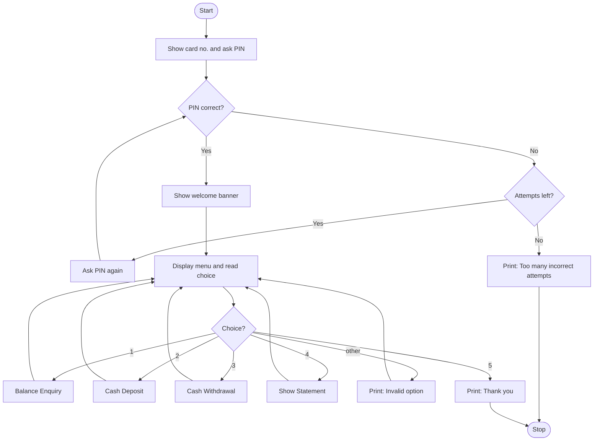

# ATM Simulator in C

> **Batch:** `26` | **Team Name:** `Encrypted`

## Team Members

| # | Name | Roll No. |
|---|------|----------|
| 1 | `Dhairya Saxena` | `590038887` |
| 2 | `Tirth Pandey` | `590034393` |
| 3 | `Siddhartha Kushwaha` | `590033224` |

---

## 1. Problem Statement

Banking customers use ATMs every day for basic tasks such as checking a balance, depositing cash, withdrawing cash and viewing recent transactions. This project builds a **console-based ATM simulator in C** that imitates these operations for a single card holder who has **three accounts**: a Savings account, a Current account and a Credit Card. The program must verify the user with a PIN, enforce realistic banking rules on every transaction, and keep a short mini statement.

## 2. Objectives

- Apply C fundamentals (functions, loops, conditionals, arrays, macros) to a realistic problem.
- Simulate PIN-based authentication with a limited number of attempts.
- Enforce account-specific rules (minimum balance, overdraft, credit limit, transaction limits).
- Validate all user input so wrong or non-numeric input never corrupts account data.
- Keep a rolling record of the last 5 transactions with unique transaction numbers.

## 3. Features

| Feature | Description |
|---|---|
| PIN authentication | 1 initial attempt + 2 retries (3 in total). The program exits after 3 wrong PINs. |
| Balance enquiry | Shows balance and *available* amount for Savings, Current and Credit accounts. |
| Cash deposit | Deposit into Savings or Current, or pay off the Credit Card. Max 50,000 per deposit. |
| Cash withdrawal | Withdraw from Savings or Current, or charge the Credit Card. Max 10,000 per withdrawal. |
| Mini statement | Shows the last 5 transactions (number, account, type, amount, resulting balance). |
| Input validation | Rejects invalid menu options, invalid account choices, zero or negative amounts, and non-numeric input. |

### Banking Rules Implemented

| Rule | Value |
|---|---|
| Minimum balance in Savings | 500 |
| Overdraft limit on Current account | 5,000 (balance may go down to -5,000) |
| Credit card limit | 35,000 |
| Maximum withdrawal per transaction | 10,000 |
| Maximum deposit per transaction | 50,000 |
| Credit card repayment | Cannot exceed the amount owed |
| PIN retries | 2 more tries after the first wrong PIN |

### Demo Account Data (initial values)

| Item | Value |
|---|---|
| Card number | 5975486021978644 (dummy) |
| PIN | 2787 |
| Savings balance | 75,084 |
| Current balance | 2,000 |
| Credit limit / owed | 35,000 / 3,000 |
| First transaction number | 1000 |

---

## 4. Algorithm

1. Start the program and call `checkPin()`.
2. Show the card number and ask for the PIN.
3. If the PIN is wrong, allow up to 2 more attempts. If all fail, print an error and **exit**.
4. On success, show the welcome banner.
5. Repeat until the user chooses **Exit (5)**:
   1. Display the menu and read the choice.
   2. Run the matching function (balance, deposit, withdrawal or statement).
   3. For an invalid choice, print "Invalid option."
6. Print "Thank you for using the ATM." and stop.

### Pseudocode

```text
START
  if checkPin() fails:
      STOP

  show welcome banner
  choice <- 0

  WHILE choice != 5
      show menu
      choice <- readInt()

      SWITCH choice
          1: balanceEnquiry()
          2: cashDeposit()
          3: cashWithdrawal()
          4: showStatement()
          5: print "Thank you"
          default: print "Invalid option"
  END WHILE
STOP

FUNCTION checkPin()
  print card number
  pin <- readInt()
  if pin == correctPIN: return TRUE
  FOR i = 1 TO MAX_TRIES
      pin <- readInt()
      if pin == correctPIN: return TRUE
  print "Too many incorrect attempts"
  return FALSE

FUNCTION cashWithdrawal()
  acc <- readInt()                      // 1 Savings, 2 Current, 3 Credit
  if acc not in 1..3: print error; return
  amt <- readInt()
  if amt <= 0 OR amt > MAX_WITHDRAWAL: print error; return

  if acc == 1:
      if savings - amt < MIN_BAL: reject; return
      savings <- savings - amt
  else if acc == 2:
      if current - amt < -OVERDRAFT: reject; return
      current <- current - amt
  else:
      if cdOwed + amt > cdLimit: reject; return
      cdOwed <- cdOwed + amt

  print transaction number and new balance
  addStatement(...)

FUNCTION cashDeposit()
  (same structure; amount limit is MAX_DEPOSIT;
   for Credit, amt must be <= cdOwed, then cdOwed <- cdOwed - amt)

FUNCTION addStatement(acc, type, amt, bal)
  if stCount == 5:
      shift every record one position left
      stCount <- 4
  store the new record at stCount
  stCount <- stCount + 1
  txNo <- txNo + 1
```

## 5. Flowchart



> GitHub renders the Mermaid diagram above automatically. For `flowchart.png`, export it from <https://mermaid.live> and save it in the repo root.

---

## 6. C Programming Concepts Used

| Concept | Where it is used |
|---|---|
| Preprocessor macros (`#define`) | `MAX_TRIES`, `MIN_BAL`, `OVERDRAFT`, `MAX_WITHDRAWL`, `MAX_DEPOSIT` |
| Global variables | Account balances, PIN, transaction counter, statement arrays |
| Functions (with and without parameters / return values) | `readInt`, `checkPin`, `balanceEnquiry`, `cashDeposit`, `cashWithdrawal`, `showStatement`, `addStatement` |
| Loops (`while`, `for`) | Main menu loop, PIN retry loop, statement shifting and printing |
| Conditionals (`if / else if / else`) | Account selection, limit checks, validation |
| `switch-case` | Main menu dispatch |
| Arrays | Parallel arrays storing the last 5 transactions |
| Strings (`char[]`) | Card number |
| Ternary operator (`?:`) | Available savings amount in balance enquiry |
| Formatted I/O (`printf`, `scanf`) | All input and output |
| Input validation | `readInt()` checks the return value of `scanf` and clears bad input |
| Relational and logical operators | `<`, `>`, `<=`, `==`, `||`, `!` |

---

## 7. How to Compile and Run

**Requirements:** any C compiler (GCC recommended), C99 or newer.

```bash
# Compile
gcc -Wall -Wextra -std=c99 -o atm atm_simulator.c

# Run (Linux / macOS / Git Bash)
./atm

# Run (Windows Command Prompt / PowerShell)
atm.exe
```

**Using the program:** enter the demo PIN `2787`, then choose options 1-5 from the menu.

---

## 8. Sample Test Cases

All "Actual Output" entries below were produced by compiling and running the submitted code.

| ID | Test Case | Input (in order) | Expected Output | Actual Output | Result |
|---|---|---|---|---|---|
| T1 | Correct PIN on first try | `2787`, `5` | Welcome banner, menu, then "Thank you for using the ATM." | Same as expected | Pass |
| T2 | Correct PIN on 3rd attempt | `1111`, `2222`, `2787`, `5` | Two "Incorrect PIN" prompts (1/2, 2/2), then access granted | Same as expected | Pass |
| T3 | Three wrong PINs | `1`, `2`, `3` | "Too many incorrect attempts. Exiting." and program ends | Same as expected | Pass |
| T4 | Balance: Savings | `2787`, `1`, `1` | `Savings Balance: 75084 \| Available to Withdraw: 74584` | Same as expected | Pass |
| T5 | Balance: Current | `2787`, `1`, `2` | `Current Balance: 2000 \| Available (with overdraft): 7000` | Same as expected | Pass |
| T6 | Balance: Credit | `2787`, `1`, `3` | `Credit Owed: 3000 \| Credit Limit: 35000 \| Available Credit: 32000` | Same as expected | Pass |
| T7 | Invalid account choice | `2787`, `1`, `9` | "Invalid account choice." | Same as expected | Pass |
| T8 | Savings withdrawal, valid | `3`, `1`, `9000` | `Transaction #1000: Withdrew 9000 from Savings. Updated Balance: 66084` | Same as expected | Pass |
| T9 | Savings withdrawal down to exactly 500 | Withdraw until balance is 5084, then `4584` | `Updated Balance: 500` (allowed) | `Transaction #1007: Withdrew 4584 from Savings. Updated Balance: 500` | Pass |
| T10 | Savings withdrawal below minimum balance | From balance 500, withdraw `1` | "Withdrawal rejected: Savings balance cannot go below 500." | Same as expected | Pass |
| T11 | Current account into overdraft limit | `3`, `2`, `7000` | `Updated Balance: -5000` | `Transaction #1000: Withdrew 7000 from Current. Updated Balance: -5000` | Pass |
| T12 | Current account beyond overdraft | From -5000, withdraw `1` | "Withdrawal rejected: Exceeds overdraft limit (5000)." | Same as expected | Pass |
| T13 | Credit card charge within limit | `3`, `3`, `10000` (three times) | Owed becomes 13000, 23000, 33000 | Same as expected | Pass |
| T14 | Credit card charge above limit | At owed 33000, charge `3000` | "Withdrawal rejected: Exceeds credit limit (35000)." | Same as expected | Pass |
| T15 | Credit card repayment | `2`, `3`, `5000` | `Paid 5000 toward Credit Card. Updated Credit Owed: 28001` | Same as expected | Pass |
| T16 | Deposit amount `0` | `2`, `1`, `0` | "Invalid amount." | Same as expected | Pass |
| T17 | Deposit negative amount | `2`, `1`, `-5` | "Invalid amount." | Same as expected | Pass |
| T18 | Deposit above maximum | `2`, `1`, `50001` | "Invalid amount." | Same as expected | Pass |
| T19 | Deposit exactly the maximum | `2`, `1`, `50000` | `Deposited 50000 into Savings. Updated Balance: 125084` | Same as expected | Pass |
| T20 | Non-numeric at menu | `abc` | "Invalid option." and the menu is shown again | Same as expected | Pass |
| T21 | Non-numeric at amount prompt | `3`, `1`, `xyz` | "Invalid amount." | Same as expected | Pass |
| T22 | Invalid menu option | `9` | "Invalid option." | Same as expected | Pass |
| T23 | Statement with no transactions | `4` | "No transactions recorded." | Same as expected | Pass |
| T24 | Statement keeps only last 5 | Make 7 deposits, then `4` | Only transactions #1002 to #1006 are listed | Txn #1002, #1003, #1004, #1005, #1006 shown | Pass |

### Sample Run (T24, shortened)

```text
--- Mini Statement ---
Txn #1002 | Acc: S | Type: D | Amount: 300 | Balance: 75684
Txn #1003 | Acc: S | Type: D | Amount: 400 | Balance: 76084
Txn #1004 | Acc: S | Type: D | Amount: 500 | Balance: 76584
Txn #1005 | Acc: C | Type: D | Amount: 600 | Balance: 2600
Txn #1006 | Acc: C | Type: D | Amount: 700 | Balance: 3300
```

Statement legend: **Acc** `S` = Savings, `C` = Current, `R` = Credit. **Type** `W` = Withdrawal, `D` = Deposit. For Credit, *Balance* means the amount still owed.

---
